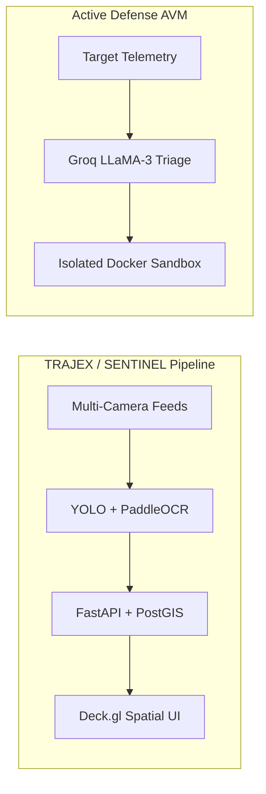

<div align="center">

<!-- HERO WAVE BANNER -->


<!-- DYNAMIC TYPING HEADLINE -->
<a href="https://jainitheshmayur.simhadwaja.com">
  
</a>

<br />

<!-- PRIMARY SOCIAL & ACTION BADGES -->
<p>
  <a href="https://jainitheshmayur.simhadwaja.com" target="_blank">
    
  </a>
  <a href="https://www.linkedin.com/in/jainitheshmayurm" target="_blank">
    
  </a>
  <a href="https://github.com/jainitheshmayurm" target="_blank">
    
  </a>
  <a href="https://x.com/jainitheshmayur" target="_blank">
    
  </a>
</p>

<!-- STATUS & METADATA STRIP -->
<p>
  
  
  
  
</p>

<!-- QUICK NAVIGATION BAR -->
<p>
  <a href="#about-me">About</a> •
  <a href="#core-engineering-pillars">Domains</a> •
  <a href="#featured-engineering-projects">Projects</a> •
  <a href="#technical-arsenal">Tech Stack</a> •
  <a href="#hackathons-and-honors">Hackathons</a> •
  <a href="#education-and-credentials">Education</a> •
  <a href="#github-telemetry">Telemetry</a> •
  <a href="#connect-and-collaborate">Connect</a>
</p>

</div>

---

## 👨‍💻 About Me

**Jai Nithesh Mayur M** is a Bengaluru-based software developer and Bachelor of Engineering (B.E.) student in **Computer Science & Engineering (Artificial Intelligence & Machine Learning)** at **AMC Engineering College (VTU)**, specializing in artificial intelligence, offensive and defensive cybersecurity, full-stack web engineering, autonomous embedded robotics, and 2D game development.

```yaml
$ whoami --verbose
name:        "Jai Nithesh Mayur M"
location:    "Bengaluru, Karnataka, India"
education:   "B.E. CSE (AI & ML) — AMC Engineering College (VTU), Class of 2029"
academic:    "8.875 First-Year CGPA | 1st Semester Class Representative (Section 'I')"
domains:
  - "AI / Machine Learning & Real-Time Computer Vision"
  - "Cybersecurity, Automated Defense & Capture the Flag (CTF)"
  - "Full-Stack Web Systems & Geospatial Cloud Architecture"
  - "Embedded IoT Robotics & Unity 2D Physics Engineering"
currently:   "Shipping hackathon-winning prototypes, AI pipelines & autonomous hardware"
open_to:     ["Internships", "Hackathon Collaborations", "Open-Source", "R&D Projects"]
```

> [!TIP]
> **Engineering Philosophy:** Build resilient, end-to-end systems that perform outside slide decks—whether that means wiring a tri-microcontroller autonomous rover, hardening kernel-isolated Docker defense sandboxes, or deploying real-time computer vision analytics.

---

## 🧩 Core Engineering Pillars

<table>
  <tr>
    <td width="25%" valign="top">
      <h4>🧠 AI &amp; Computer Vision</h4>
      <p>Multi-camera ANPR tracking, OCR pipelines, custom PyTorch architectures (VAEs &amp; CNNs), and automated LLM media workflows.</p>
    </td>
    <td width="25%" valign="top">
      <h4>🛡️ Cybersecurity &amp; CTFs</h4>
      <p>Autonomous vulnerability management, LLM-assisted threat triage, kernel-isolated Docker sandboxes, digital forensics, and reverse engineering.</p>
    </td>
    <td width="25%" valign="top">
      <h4>🌐 Full-Stack &amp; Cloud</h4>
      <p>Low-latency REST &amp; WebSocket APIs, PostGIS spatial databases, conflict-free scheduling engines, and responsive React frontends.</p>
    </td>
    <td width="25%" valign="top">
      <h4>🤖 IoT Robotics &amp; Games</h4>
      <p>Multi-MCU rover telemetry, dead-reckoning Return-to-Home navigation, ultrasonic obstacle detouring, and Unity 2D ricochet physics.</p>
    </td>
  </tr>
</table>

---

## 🚀 Featured Engineering Projects

A curated snapshot of my flagship builds across **AI/ML**, **Cybersecurity**, **Full-Stack Web**, **Embedded IoT**, and **Game Engineering**:

| Project | Domain | Architecture & Impact | Core Stack |
| :--- | :--- | :--- | :--- |
| **TRAJEX / SENTINEL** | `AI & Computer Vision` | City-wide multi-camera ANPR vehicle trajectory tracking and two-tier privacy-preserving traffic analytics platform *(Smart India Hackathon 2026)*. | `YOLO` `PaddleOCR` `FastAPI` `PostGIS` `Deck.gl` |
| **Active Defense AVM** | `Cybersecurity & LLM` | Automated vulnerability assessment and active defense orchestration using kernel-isolated containers *(HACKZION V.3 — Security Architect, Team SPACE SYNTAX)*. | `Python` `Groq LLaMA-3` `Docker` `Streamlit` |
| **SMART HERS Rover** | `Embedded IoT & Robotics` | Tri-node hazardous environment response rover with LIFO dead-reckoning Return-to-Home (RTH) navigation, live MJPEG telemetry, and active obstacle detouring. | `ESP32` `ESP32-CAM` `Arduino Uno` `L293D` `WebSockets` |
| **Meeting Slot Booking** | `Full-Stack Web` | 🏆 **1st Prize Overall (Gen-Blaze 2026)** — Real-time institutional scheduling and conflict-free slot allocation engine with relational persistence. | `React (Vite)` `Node.js` `Express` `PostgreSQL` |
| **OOYL: Respawn Sci-Fi** | `Game Engineering` | 2D top-down sci-fi action RPG built for **RESPAWN 12-Hour Game Jam (RUAS)** featuring geometric bullet ricochet physics, lightsaber deflection, and time dilation. | `Unity 6.3 LTS` `C#` `URP 2D` `Physics2D` |
| **Developer Portfolio** | `Interactive Web` | Interactive single-page developer portfolio at [jainitheshmayur.simhadwaja.com](https://jainitheshmayur.simhadwaja.com) featuring custom particle networks and a terminal UI. | `HTML/CSS/JS` `Bootstrap` `ASP.NET MVC` |

<details>
<summary><b>🔎 Explore Additional Builds, Deep Learning Research &amp; System Architecture</b></summary>

<br />

- **AUTONOM — Automated Short-Form Video Pipeline:** Modular Python automation workflow integrating Groq Whisper transcription, FFmpeg programmatic video assembly, and automated QA gates.
- **Smart Health Link:** QR-code-driven hospital patient registration and OPD intake prototype engineered with **React.js** and **Supabase**.
- **Deep Learning from Scratch (PyTorch):**
  - *Variational Autoencoder (VAE):* Custom encoder-decoder latent space generative model with reparameterization trick trained on FashionMNIST.
  - *Handwritten Digit Recognition Engine:* Custom neural network paired with **OpenCV** contour preprocessing and an interactive **Gradio** Sketchpad UI.



</details>

---

## 🛠️ Technical Arsenal

<table>
  <tr>
    <td width="22%"><b>Languages</b></td>
    <td>
      
      
      
      
      
      
      
      
    </td>
  </tr>
  <tr>
    <td><b>AI, ML &amp; Vision</b></td>
    <td>
      
      
      
      
      
      
      
    </td>
  </tr>
  <tr>
    <td><b>Web, APIs &amp; Data</b></td>
    <td>
      
      
      
      
      
      
      
      
      
    </td>
  </tr>
  <tr>
    <td><b>Security &amp; DevOps</b></td>
    <td>
      
      
      
      
      
    </td>
  </tr>
  <tr>
    <td><b>IoT, Hardware &amp; 3D</b></td>
    <td>
      
      
      
      
      
    </td>
  </tr>
</table>

---

## 🏆 Hackathons and Honors

| Event | Role & Recognition | Host / Organization | Year |
| :--- | :--- | :--- | :---: |
| **Gen-Blaze Hackathon** | 🥇 **1st Prize Overall Winner** *(Team Lead & Full-Stack Dev)* | AMCEC ISE Dept, iFocus Systec & IEEE SPS | `2026` |
| **HACKZION V.3 National Cyber Security Hackathon** | 🛡️ **Security Architect & Full-Stack Dev** *(Team SPACE SYNTAX)* | National Cyber Security Hackathon | `2026` |
| **Cipher Chase '26 CTF** | 🚩 **24-Hour Capture the Flag Competitor** *(Forensics & RE)* | IIITB Zense, IIIT Bangalore | `2026` |
| **Smart India Hackathon (SIH)** | 💻 **System Architect** *(TRAJEX / SENTINEL & Waste-to-Energy)* | Ministry of Education Innovation Cell | `2025–2026` |
| **RESPAWN 12-Hour Game Jam** | 🎮 **Unity Gameplay & Physics Developer** *(OOYL: Respawn Sci-Fi)* | Pravrutti 2.0, Ramaiah University (RUAS) | `2026` |
| **Tech-o-Ween Hackathon** | 🏅 **Podium Finisher** | DataVerse & CSE-DS, AMCEC | `2025` |
| **NASA Space Apps & IIT Bombay Techfest Zonals** | 🛰️ **Competitor** *(Bengaluru Regional Rounds)* | NASA (DSU) & IIT Bombay (GAT) | `2026` |

*Frequent engineering collaborator with fellow AMC Engineering College builders, including my twin brother **Jai Nitin Mayur M**.*

---

## 🎓 Education and Credentials

### Bachelor of Engineering (B.E.) — Computer Science & Engineering (AI & ML)
**AMC Engineering College (Autonomous), Bengaluru** • *Affiliated with Visvesvaraya Technological University (VTU)*  
`2025 – 2029 (Expected)` • **First-Year CGPA:** `8.875 / 10.0` • *1st Semester Class Representative (Section 'I')*

<details>
<summary><b>📜 Verified Certifications &amp; Technical Programs</b></summary>

<br />

- **Infosys Springboard** — Virtual Internship 7.0
- **Infosys Springboard** — Java 11 Certification & Artificial Intelligence Certification
- **SWAYAM / NPTEL** — Design Thinking and Innovation (DT&I)
- **Google Cloud** — Learn with Communities Campaign & *Build with AI* Hands-on Agent Workshop

</details>

---

## 📊 GitHub Telemetry

<div align="center">

<p>
  
  
</p>

<p>
  
</p>

<p>
  
</p>

</div>

---

## 🤝 Connect and Collaborate

I am always open to collaborating on **AI/ML systems, cybersecurity research, full-stack products, embedded robotics, and national hackathons**.

<div align="center">

| Platform | Handle / Direct Link |
| :--- | :--- |
| 🌐 **Portfolio** | [jainitheshmayur.simhadwaja.com](https://jainitheshmayur.simhadwaja.com) |
| 🐙 **GitHub** | [github.com/jainitheshmayurm](https://github.com/jainitheshmayurm) |
| 💼 **LinkedIn** | [linkedin.com/in/jainitheshmayurm](https://www.linkedin.com/in/jainitheshmayurm) |
| 🐦 **X (Twitter)** | [x.com/jainitheshmayur](https://x.com/jainitheshmayur) |

<br />


</div>
